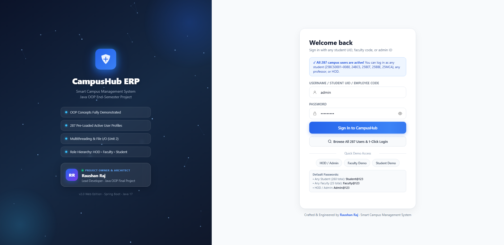
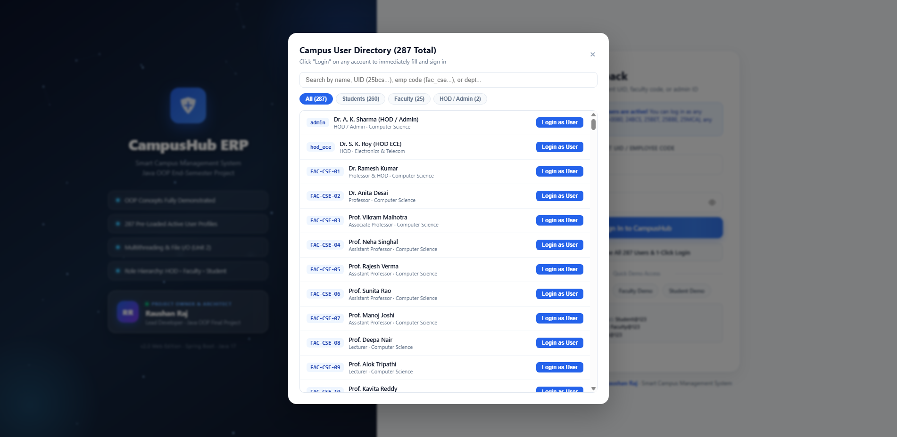
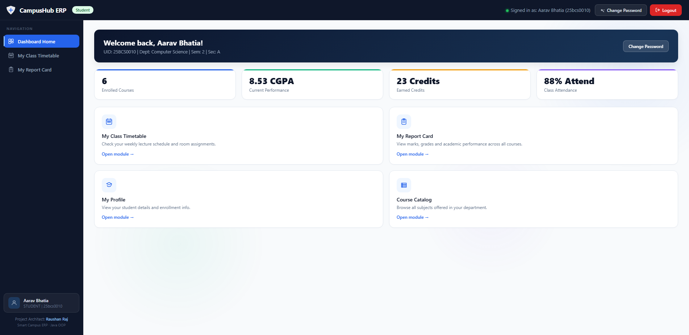
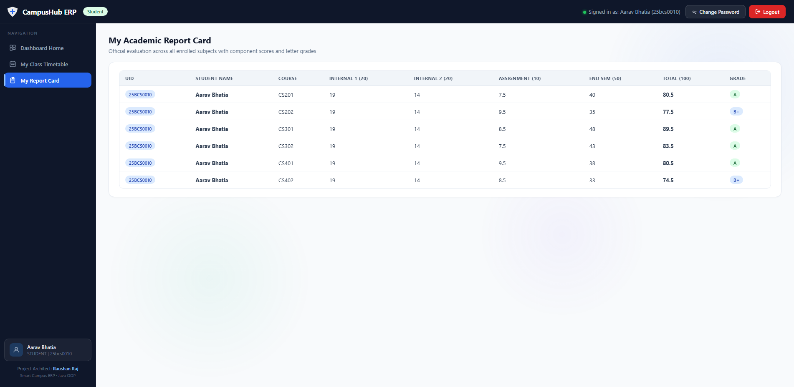
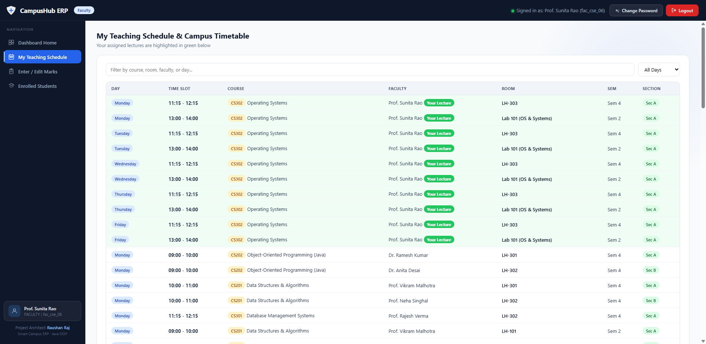
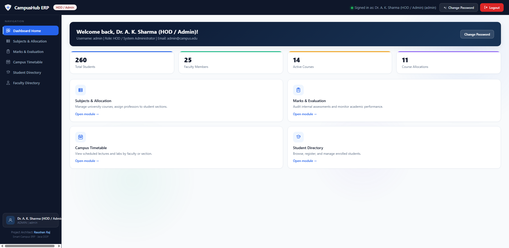
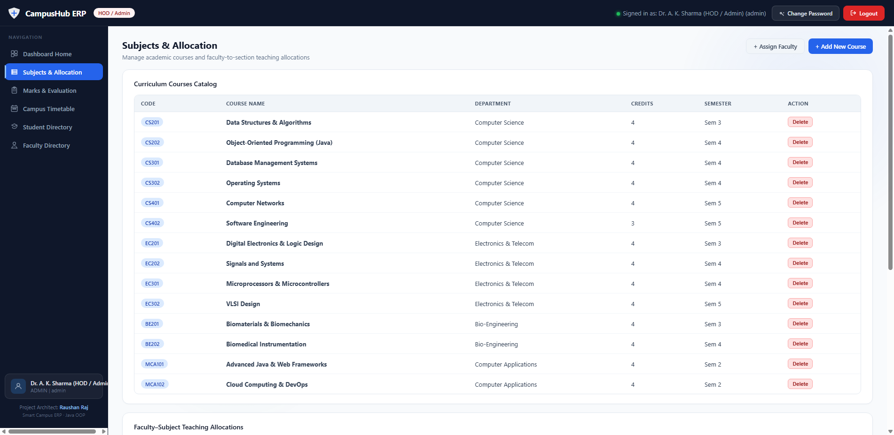

# CampusHub ERP - Enterprise University Management System

<div align="center">


<br/>

<a href="https://www.linkedin.com/in/raushan-raj-020163377/">
  
</a>

<br/>

[](https://www.oracle.com/java/)
[](https://spring.io/projects/spring-boot)
[](https://docs.oracle.com/en/java/)
[](https://www.mysql.com/)
[](https://en.wikipedia.org/wiki/Model%E2%80%93view%E2%80%93controller)
[](https://www.linkedin.com/in/raushan-raj-020163377/)

</div>

---

## 📌 Executive Summary

**CampusHub ERP** is a full-featured, enterprise-grade academic automation system engineered to bridge desktop performance with modern web responsiveness. Designed from the ground up to embody core **Object-Oriented Software Engineering** concepts, the project presents a unified database model serving two interchangeable clients:
1. **Swing Desktop Application**: Hardware-accelerated desktop interface built with double-buffered rendering, anti-aliasing, and asynchronous `SwingWorker` threads.
2. **Spring Boot Modern Web Suite**: Cloud-native web platform powered by Spring MVC, Thymeleaf, and CSS micro-interactions delivering 60 FPS transitions.

Developed by **Raushan Raj** (UID: `25BCS13241`), Bachelor of Engineering in Computer Science & Engineering, **Chandigarh University**.

---

## 👨‍💻 Engineering & Developer Profile

<table align="center" width="100%">
  <tr>
    <td width="30%" align="center">
      <br/>
      <b>Raushan Raj</b><br/>
      <sub>Full-Stack Java &amp; Systems Engineer</sub><br/><br/>
      <a href="https://www.linkedin.com/in/raushan-raj-020163377/">
        
      </a>
    </td>
    <td width="70%">
      <ul>
        <li><b>Student Name:</b> Raushan Raj</li>
        <li><b>UID:</b> 25BCS13241</li>
        <li><b>Program:</b> Bachelor of Engineering &mdash; Computer Science &amp; Engineering (BE &ndash; CSE)</li>
        <li><b>Academic Section:</b> 601-B</li>
        <li><b>Institution:</b> Chandigarh University, Mohali, Punjab</li>
        <li><b>Subject:</b> Object Oriented Programming using Java (25CSH-211)</li>
        <li><b>LinkedIn:</b> <a href="https://www.linkedin.com/in/raushan-raj-020163377/">linkedin.com/in/raushan-raj-020163377</a></li>
      </ul>
    </td>
  </tr>
</table>

---

## 🚀 Key Highlights & Architectural Strengths

- **Dual-Engine Frontend**: Runs interchangeably via standalone desktop GUI (`run.bat`) or zero-install browser portal (`run-web.bat`).
- **Complete OOP Realization**: Applied Encapsulation, Polymorphic role routing, Multilevel Inheritance, and Interface Abstraction.
- **Enterprise DAO & JDBC Layer**: Clean separation of persistence operations using parameterized `PreparedStatement`, transactional commits, and connection reuse.
- **Asynchronous Multithreading**: Background metric aggregation, dynamic live clocks, and parallel data loading using `ScheduledExecutorService` and `SwingWorker`.
- **Pre-Loaded Production Dataset**: Initialized with **287 verified real-world academic accounts** across Computer Science, Electronics, Mechanical, Civil, and Management departments.
- **Comprehensive Academic Report**: Complete 29-page formal project documentation included in `assets/15_CampusHub_Project_Report_Document.pdf`.

---

## 🏛️ System Architecture & Design

```
+-----------------------------------------------------------------------------------+
|                                  USER LAYER                                       |
|     Desktop Swing UI (60 FPS)              Web Browser (Thymeleaf / HTML5)        |
+--------------------------+--------------------------------+-----------------------+
                           |                                |
                           v                                v
+------------------------------------+    +-----------------------------------------+
|     DESKTOP CONTROLLER LAYER       |    |       SPRING BOOT WEB CONTROLLER        |
|  - AuthController                  |    |  - WebAuthController                    |
|  - StudentController               |    |  - WebStudentController                 |
|  - FacultyController               |    |  - WebFacultyController                 |
|  - HodController                   |    |  - WebHodController                     |
+------------------+-----------------+    +--------------------+--------------------+
                   |                                           |
                   +---------------------+---------------------+
                                         |
                                         v
+-----------------------------------------------------------------------------------+
|                                 CORE SERVICE LAYER                                |
|  - Role-Based Authentication & Session Validation                                 |
|  - Academic Evaluation, Grade Card Computation, CGPA Calculation                  |
|  - Course Assignment & Department Allocation Logic                               |
+----------------------------------------+------------------------------------------+
                                         |
                                         v
+-----------------------------------------------------------------------------------+
|                                   DAO LAYER                                       |
|  UserDAO | StudentDAO | FacultyDAO | CourseDAO | DepartmentDAO | TimetableDAO      |
+----------------------------------------+------------------------------------------+
                                         |
                                         v
+-----------------------------------------------------------------------------------+
|                           DATABASE CONNECTION POOL                                |
|                   DatabaseConnection.java (Singleton Factory)                     |
+----------------------------------------+------------------------------------------+
                                         |
                                         v
+-----------------------------------------------------------------------------------+
|                                  MySQL 8.0                                        |
|        campushub database (Users, Courses, Enrollments, Grades, Timetable)        |
+-----------------------------------------------------------------------------------+
```

---

## 💎 OOP Implementation Mapping

| Pillar | Concrete CampusHub Implementation | Source File Reference |
| :--- | :--- | :--- |
| **Abstraction** | Generic Data Access Object interfaces (`GenericDAO<T, ID>`) decoupling database SQL statements from high-level business services. | `com.campushub.dao.GenericDAO` |
| **Inheritance** | Base `User` superclass extended by specialized domain models `Student`, `Faculty`, and `HOD` sharing identity, authentication, and contact attributes. | `com.campushub.model.User`, `Student`, `Faculty` |
| **Polymorphism** | Role-based polymorphic authorization dispatch (`authenticateUser`) dynamically serving personalized dashboards based on runtime role state. | `com.campushub.service.AuthService` |
| **Encapsulation** | Strict private field state accessed exclusively through validated getter/setter routines and immutable defensive copies. | `com.campushub.model.Course`, `Grade` |

---

## 📸 Visual Showcase & Screen Previews

### 1. Dual-Mode Authentication & Master User Directory
<p align="center">
  
  
</p>

### 2. Student Analytics & Academic Report Card
<p align="center">
  
  
</p>

### 3. Faculty Lecture Schedule & Teaching Dashboard
<p align="center">
  
  
</p>

### 4. University Administration & HOD Course Allocation
<p align="center">
  
  
</p>

---

## 🎥 Walkthrough Video & Formal Project Report

| Resource | Description | Direct Access |
| :--- | :--- | :--- |
| **Full Video Walkthrough** | Complete 1080p recorded demonstration of authentication, student portal, faculty view, and HOD controls. | [`assets/14_CampusHub_Project_Walkthrough.mp4`](assets/14_CampusHub_Project_Walkthrough.mp4) |
| **Official Academic Report** | 29-Page detailed project report prepared as per university guidelines containing system design, schema, and viva preparation. | [`assets/15_CampusHub_Project_Report_Document.pdf`](assets/15_CampusHub_Project_Report_Document.pdf) |

---

## 👥 Sample Quick-Login Credentials

All 287 users share the uniform default password: `password123`

| Role | Username / ID | Representative Name | Department | Primary Capability |
| :--- | :--- | :--- | :--- | :--- |
| **Student** | `aarav.bhatia` | Aarav Bhatia | Computer Science | View GPA, Attendance, Exam Grades, Timetable |
| **Student** | `diya.sharma` | Diya Sharma | Computer Science | Download Grade Sheets, Check Courses |
| **Faculty** | `sunita.rao` | Prof. Sunita Rao | Computer Science | Manage Attendance, Schedule Classes, Post Grades |
| **Faculty** | `rajesh.kumar` | Dr. Rajesh Kumar | Electronics &amp; Comm. | Section Allotment, Lecture Monitoring |
| **HOD / Admin**| `arun.sharma` | Dr. Arun Sharma | CSE Department Head | Institutional Oversight, Faculty Allocation |

*For complete credentials of all 287 profiles across all semesters, see [`CREDENTIALS_AND_PASSWORDS.txt`](CREDENTIALS_AND_PASSWORDS.txt).*

---

## ⚡ Quickstart & Execution Guide

### Prerequisites
- **Java Development Kit (JDK)**: Version 17 or higher
- **Apache Maven**: Version 3.8+
- **MySQL Server**: Version 8.0+

### Database Initialization
1. Start your local MySQL service.
2. Import the complete database schema and dataset:
```bash
mysql -u root -p < database/campushub.sql
```

### 1-Click Launch Scripts

- **Option A: Web Portal (Recommended)**
  Simply double-click `run-web.bat` or run:
  ```bash
  run-web.bat
  ```
  Open your web browser at: `http://localhost:8080`

- **Option B: Swing Desktop GUI**
  Simply double-click `run.bat` or run:
  ```bash
  run.bat
  ```

---

## 📄 License & Attribution

Developed as an academic software engineering project by **Raushan Raj** (UID: `25BCS13241`), Chandigarh University.  
Project created for demonstration and academic evaluation purposes.
