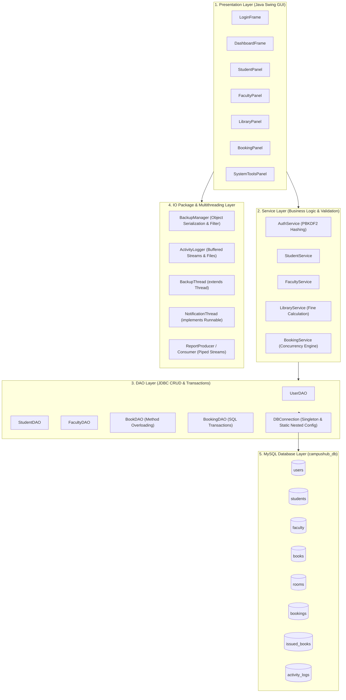
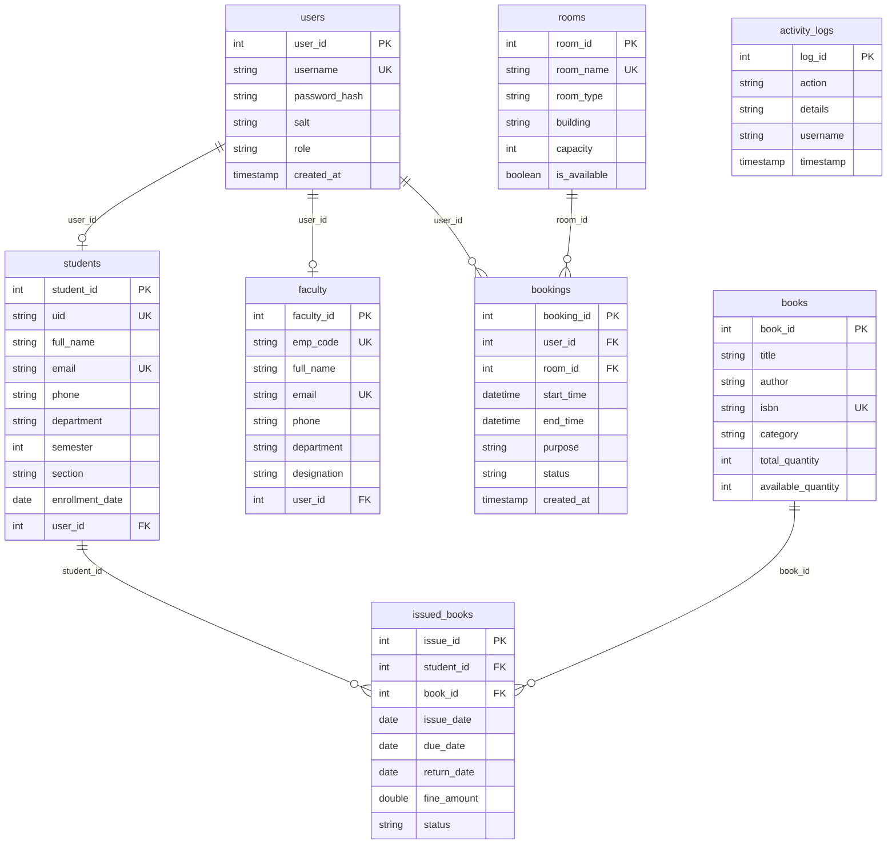

# CampusHub – UML Diagrams & Architecture

This document contains complete UML representations of **CampusHub – Smart Campus Management System** rendered via standard GitHub Mermaid format.

---

## 1. Class Inheritance & Interface Implementation Hierarchy

```mermaid
classDiagram
    direction TB

    class Serializable {
        <<interface>>
    }

    class Authenticatable {
        <<interface>>
        +authenticate(String password) boolean
        +getRole() String
    }

    class BookOperations {
        <<interface>>
        +issueBook(int bookId) void
        +returnBook(int bookId) void
    }

    class BookingOperations {
        <<interface>>
        +reserveRoom(int roomId, LocalDateTime start, LocalDateTime end, String purpose) boolean
        +cancelReservation(int bookingId) boolean
    }

    class Person {
        <<abstract>>
        #String name
        #String email
        +Person()
        +Person(String name, String email)
        +getDetails()* String
        +getName() String
        +getEmail() String
    }

    class User {
        <<abstract>>
        #int userId
        #String username
        #String passwordHash
        #String salt
        #String role
        +User()
        +User(int id, String name, String email, String username, String hash, String salt, String role)
        +getRole()* String
        +getDetails() String
        +authenticate(String password) boolean
    }

    class Student {
        -int studentId
        -String uid
        -String phone
        -String department
        -int semester
        -String section
        -LocalDate enrollmentDate
        +Student()
        +Student(String uid, String name, ...)
        +Student(Student source)
        +getRole() String
        +getDetails() String
        +issueBook(int bookId) void
        +returnBook(int bookId) void
    }

    class Faculty {
        -int facultyId
        -String empCode
        -String phone
        -String department
        -String designation
        +Faculty()
        +Faculty(String empCode, String name, ...)
        +getRole() String
        +getDetails() String
    }

    class Admin {
        -String adminLevel
        +Admin()
        +Admin(int id, String name, String email, ...)
        +getRole() String
        +getDetails() String
    }

    class Book {
        -int bookId
        -String title
        -String author
        -String isbn
        -String category
        -int totalQuantity
        -int availableQuantity
        +isAvailable() boolean
        +issueCopy() void
        +returnCopy() void
    }

    class Room {
        -int roomId
        -String roomName
        -String roomType
        -String building
        -int capacity
        -boolean available
        +bookRoom() synchronized boolean
        +releaseRoom() synchronized void
    }

    class Booking {
        -int bookingId
        -int userId
        -int roomId
        -LocalDateTime startTime
        -LocalDateTime endTime
        -String purpose
        -String status
        +getBookingDetails() BookingDetails
    }

    class BookingDetails {
        <<inner class>>
        -String generatedTimestamp
        +getReservationPass() String
        +getOuterBooking() Booking
    }

    %% Relationships
    Serializable <|.. Person
    Serializable <|.. Book
    Serializable <|.. Room
    Serializable <|.. Booking

    Person <|-- User
    Authenticatable <|.. User

    User <|-- Student
    User <|-- Faculty
    User <|-- Admin

    BookOperations <|.. Student
    Booking +-- BookingDetails
```

---

## 2. Layered Application Architecture Diagram



---

## 3. Database Entity-Relationship (ER) Diagram



